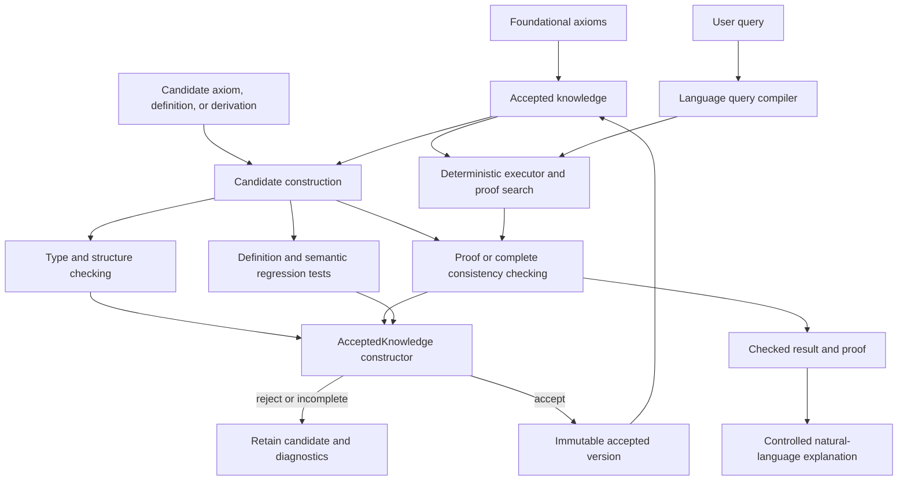

# Know: A Computational Metaphysical Framework

## Status

Proposed research direction.

## Thesis

Know seeks to computationally articulate the necessary structure of any possible
reality, then construct knowledge by making explicit what follows from that structure
and what requires further conditions.

The product is a body of runnable knowledge built upward from explicit philosophical
foundations. A language, type system, compiler, proof checker, ontology, and specialized
reasoners are instruments for constructing and executing that body; none is the goal by
itself.

The immediate work is to make foundational reasoning concrete:

```txt
What does this definition assert?
Which established meanings does it use?
Is it internally coherent?
How do two concepts relate?
Does this statement follow from the accepted foundation?
Would accepting it introduce a contradiction?
Which additional conditions would establish it?
What is the complete derivational chain?
```

Know begins with explicit foundational axioms under a governing requirement of
noncontradiction. Definitions construct new meanings from established meanings.
Derivations construct new statements from accepted commitments. Further axioms or
conditions may extend the body, but their contribution must remain visible in every
conclusion that depends upon them.

The essential construction is:

```txt
foundational axioms
    -> definitions
    -> derived statements
    -> further explicit conditions
    -> higher-level concepts and knowledge
```

Every accepted contribution enters as one of these:

```txt
axiom                 an explicitly adopted foundational commitment
definition            a construction expressed through established meanings
derived statement     a conclusion established by a checked derivation
conditional statement a conclusion whose additional premises remain explicit
```

Definitions must not conceal axioms. Derivations must not conceal assumptions.
Conditional conclusions must not silently become unconditional.

The intended result is an indefinitely extensible computational body with these
properties:

```txt
- accepted knowledge is constructible only through consistency-preserving operations
- concepts express determinate meanings rather than merely occupying schema slots
- definitions expose their dependencies and exact logical consequences
- concept comparisons state precisely which relationship has been established
- every deductive conclusion has a checkable derivation or an explicit backend assurance
- every additional condition remains visible in the conclusions that require it
- contradictory content can be examined without entering the accepted body
- every accepted revision is explicit, inspectable, replayable, and reversible
```

---

## 1. What Is Being Built?

This project is a language and runtime for constructing knowledge from philosophical
foundations.

It makes several operations executable:

```txt
state a foundational commitment precisely
construct a definition from established meanings
check whether a definition can be inhabited coherently
compare concepts by implication, equivalence, overlap, and exclusion
derive a statement from accepted commitments
reject an extension that would create a contradiction
identify conditions missing from a proposed derivation
reconstruct the dependencies of every conclusion
```

The accepted body is not an unrestricted collection of statements. It is a constrained
computational value whose public construction paths preserve its invariants:

```txt
accepted knowledge
    + proposed contribution
    -> structural and semantic checking
    -> complete consistency decision
    -> new accepted knowledge
```

If checking cannot complete, construction does not succeed. Candidate statements,
quoted claims, rejected arguments, and inconsistent proposals may be represented for
inspection without becoming accepted commitments.

Words are not the units of meaning. A word can refer to several concepts, and several
words can refer to one concept. Know resolves intended concepts before checking a
definition, comparison, or statement.

The same body may later support empirical and domain knowledge, but those are built by
adding explicit conditions above the foundation. Physical laws, broad empirical
ingestion, and autonomous self-editing are not the initial organizing goals.

An LLM may propose axioms, definitions, arguments, formalizations, proofs, and
counterexamples. It is never the authority that admits them. Its proposals must become
independent computational objects that can be checked without trusting the model.

The desired execution path is:

```txt
question
    -> resolved meanings
    -> normalized logical statement
    -> accepted definitions and commitments
    -> checked derivation or capability-bounded decision
    -> answer with complete dependencies and assurance
```

---

## 2. Design Goals

### 2.1 Primary goals

The language must:

1. Represent foundational axioms, definitions, conditions, propositions, proofs, and
   their dependencies.
2. Distinguish words from the concepts they may express.
3. Make definitions state exact constructions over established meanings.
4. Check whether definitions are coherent, circular, satisfiable, or contradictory.
5. Compare concepts by explicitly named relationships rather than lexical resemblance.
6. Make accepted knowledge constructible only through operations that preserve
   noncontradiction.
7. Preserve the complete assumptions and definitions used by each conclusion.
8. Represent quoted or rejected contradictions without admitting them as commitments.
9. Distinguish a checked proof from a backend decision, incomplete search, unsupported
   semantics, and internal failure.
10. Revise the articulated foundation without hiding what changed or invalidating old
    results silently.

### 2.2 Non-functional goals

| Property | Requirement |
|---|---|
| Meaningfulness | Every accepted record contributes substantive understanding |
| Consistency by construction | Contradictory commitments cannot inhabit the accepted knowledge type |
| Dependency completeness | Every conclusion exposes all axioms, definitions, and conditions it requires |
| Semantic precision | Every comparison names the exact relationship it establishes |
| Determinism | A program version, query, and resource policy produce a reproducible result |
| Soundness | The trusted kernel accepts only well-typed proof terms constructed by its rules |
| Replayability | Every theory version and revision can be reconstructed exactly |
| Minimal trusted base | Models, search, scoring, and patch generation remain untrusted |
| Inspectability | Every result exposes its premises, definitions, context, and proof |
| Incrementality | Small revisions recheck only affected dependency regions when safe |
| Extensibility | New concepts and relations are ordinary programs, not kernel changes |
| Failure safety | Failed proof search returns `unknown`; it never becomes falsity or truth |
| Security | Quoted or imported code cannot execute or alter the verifier implicitly |
| Portability | The language has a formal specification independent of one LLM vendor |

### 2.3 Knowledge is the product, not scaffolding

The accepted knowledge program must grow toward a complete body of knowledge. It is
not a collection of schema demonstrations, illustrative stubs, or records waiting to
be filled in later.

**Boilerplate is never acceptable as knowledge.** Do not admit placeholder IDs, dummy
values, generic provenance, empty metadata, vacuous definitions, or schema-shaped
records merely because they parse or exercise an implementation path. Every accepted
record must deepen the shared account of its subject.

Incomplete checking is not successful construction. If a proposed contribution cannot
be checked to the assurance required by its accepted type, it remains a candidate
outside the accepted body. `Unknown` is a valid result of a complete query over open
knowledge; it is not permission to admit unchecked commitments. Examples and test
fixtures remain outside the accepted corpus unless their claims meet the same standard
as production knowledge.

### 2.4 Non-goals

The first language should not attempt to:

```txt
- reproduce every behavior of the source LLM
- store prose as though prose were formal knowledge
- decide every expressible proposition
- convert model confidence directly into truth
- allow the program to redefine what counts as a valid proof
- erase disputed or rejected claims from history
- treat a backend verdict without a certificate as a kernel-checked proof
- make physical or empirical theory the starting foundation
- hide additional axioms inside definitions
```

---

## 3. The One-Language Principle

The project should have one canonical language and one semantics.

It should not make a property graph the meaning layer, use fuzzy truth as a second
meaning layer, attach a different modal engine for obligations, and then serialize the
whole construction through configuration records. Those may become implementation
techniques, but none of them defines knowledge.

The canonical source program should be sufficient to state:

```txt
what objects exist
what expressions mean
what is being assumed
what a source said
what evidence supports
what follows
what changed
why a change was accepted
```

Search indexes, databases, caches, and optimized executors are compiler products. They
can be deleted and rebuilt from the knowledge program without changing its meaning.

### 3.1 Accepted knowledge is a type boundary

`KnowledgeModule` and other intermediate representations may contain candidate or
inconsistent material so that it can be diagnosed. They are not, by themselves, the
accepted body.

The accepted body must be represented by a type that cannot be constructed or mutated
without passing the required checks:

```txt
CandidateKnowledge
    -> parse and type check
    -> resolve every referenced meaning
    -> complete consistency check
    -> dependency validation
    -> AcceptedKnowledge
```

If a contradiction is explicit or follows from the candidate commitments, construction
fails. If consistency checking is unsupported, incomplete, resource-limited, or fails
internally, construction also fails. The candidate remains available for examination but
does not inhabit `AcceptedKnowledge`.

Local invariants belong in ordinary data types. Invariants that require inference belong
at the accepted-body constructor. No public operation may mutate accepted knowledge
without producing another checked value.

### 3.2 Candidates, quotations, and accepted commitments

The system must be able to discuss an invalid or contradictory statement without
accepting it:

```txt
Candidate<P>       P is proposed for checking
Quote<P>           P is inert content under examination
Rejected<P>        P failed a recorded admission obligation
Proof<P>           P has a kernel-checked derivation
AcceptedPremise<P> P was explicitly admitted as a foundational or conditional axiom
```

There is no implicit conversion from candidate, quotation, report, or evidence into an
accepted premise.

---

## 4. Foundational Calculus

The calculus is the executable foundation for constructing definitions and checking
what follows from accepted principles. Its rules must preserve noncontradiction and make
every dependency explicit. Foundational axioms state the primitive philosophical
commitments of the current account; checked derivations establish their consequences.

The calculus does not silently add principles. If a result requires an additional axiom
or context, that condition remains part of the result's dependency chain.

### 4.1 Recommended foundation

Use a small, total, dependently typed lambda calculus with:

```txt
- inductive data types
- functions and application
- a universe of propositions, Prop
- proof terms, Proof<P>
- parametric and dependent types
- terminating recursion
- stratified quotation, Quote<T>
- immutable theory and revision values
```

The “propositions as types, proofs as programs” interpretation makes theorem checking a
form of type checking:

```txt
proof p : Proof<P>
```

means that the term `p` certifies proposition `P` under its declared assumptions.

The core should be smaller than its standard library. English-specific notions such as
ownership, causation, permission, species, or marriage are library definitions—not
primitive features of the kernel.

### 4.2 Why a typed calculus?

A typed calculus can reject category mistakes before reasoning:

```txt
relation parent_of : Person -> Person -> Prop

parent_of(blue, Tuesday)
```

fails because neither argument is a `Person`.

Types alone do not prove factual truth, but they make the language's distinctions
explicit and prevent entire classes of malformed propositions.

### 4.3 Why totality?

Functions used by the kernel must terminate. Unrestricted general recursion would make
type checking and proof checking capable of diverging.

Potentially unbounded theorem search remains outside the kernel. Search may time out;
checking a proof it discovers must terminate.

### 4.4 Classical reasoning

Noncontradiction is a governing invariant of accepted knowledge. Other classical
principles should not be imported merely because a backend assumes them. A context may
explicitly adopt an additional principle when required:

```txt
context ClassicalMathematics {
    assume excluded_middle : forall p: Prop. p or not p
}
```

This keeps dependencies visible while retaining one calculus. “Classical,” “legal,” or
“probabilistic” need not mean separate runtimes; they can be libraries of types,
relations, and rules expressed in the same language.

---

## 5. Core Kinds and Types

The following names are illustrative surface syntax, not commitments to their internal
encoding.

### 5.1 Entity

An `Entity` is a particular referent:

```txt
entity socrates : Person
entity earth : Planet
entity declaration_of_independence : Document
```

Entity identity is asserted explicitly. Similar names or embeddings never merge
entities automatically.

### 5.2 Concept

A `Concept` is a predicate over some domain. Surface syntax can make the common case
concise:

```txt
concept Animal : Entity
concept Mammal : Entity
concept Dog : Entity
```

Concept membership is a proposition:

```txt
Dog(fido)
Mammal(fido)
```

A concept may be defined rather than merely declared:

```txt
define Bachelor(x: Entity) : Prop :=
    Person(x)
    and Adult(x)
    and Male(x)
    and NeverMarried(x)
```

### 5.3 Relation

A `Relation` is a typed function returning a proposition:

```txt
relation owns : Person -> Asset -> Prop
relation located_in : Entity -> Place -> Prop
relation before : Event -> Event -> Prop
relation is_a : Concept -> Concept -> Prop
```

The ordinary function type is sufficient; `relation` is useful declarative syntax and
documentation.

### 5.4 Proposition

A `Prop` is something for which a proof may be requested:

```txt
Dog(fido)
forall x: Entity. Dog(x) -> Mammal(x)
not located_in(fido, chicago)
```

A proposition is not a floating truth value between zero and one. Uncertainty is
represented by evidence or probability claims *about* a proposition.

### 5.5 Context

A `Context` is a named theory containing definitions, premises, and derived theorems:

```txt
context FoundationalAccount {
    define ...
    premise ...
    theorem ...
}
```

Contexts can import other contexts explicitly:

```txt
context ConditionalTheory {
    import FoundationalAccount
    assume AdditionalCondition
}
```

Every executable context accepted by the body must satisfy its declared consistency
obligation. Incompatible candidate theories may coexist as quoted or separately named
objects for comparison, but they are not jointly imported into one accepted executable
context. Import conflicts fail construction unless an explicit, consistency-preserving
resolution is supplied.

### 5.6 Definition

A definition introduces an exact abbreviation or construction:

```txt
define Grandparent(x: Person, z: Person) : Prop :=
    exists y: Person.
        parent_of(x, y) and parent_of(y, z)
```

Expanding a definition must not add a new assumption. Pure definitions are therefore
conservative extensions: they add vocabulary without changing what was previously
provable in the old vocabulary.

A definition is checked separately from the word or words that may refer to it. The
framework must be able to compare definitions through several distinct relations:

```txt
same canonical concept
definitionally equal after normalization
logically equivalent conditions
strictly narrower or broader
overlapping but not equivalent
mutually exclusive
logical negations
relationship unresolved
```

No one relationship may be reported as another. In particular, equivalent extensions
do not by themselves establish identical meaning.

### 5.7 Quotation

Quotation turns code into inert typed data:

```txt
`earth revolves_around sun`
```

has a type resembling:

```txt
Quote<Prop>
```

The quoted proposition is not evaluated or asserted.

### 5.8 Claim

A claim relates an agent or source to a quoted proposition:

```txt
claim source_17 says `whales are fish`
```

This establishes something like:

```txt
claims(source_17, `whales are fish`)
```

It does not establish:

```txt
whales are fish
```

This is how the program may refer to contradictions without asserting contradictions.

### 5.9 Evidence

Evidence is neither a proposition nor a proof of that proposition:

```txt
evidence specimen_42 supports `BlueWhale(specimen_42)`
evidence genome_analysis supports `Mammal(specimen_42)`
```

Evidence can be inspected by an adoption policy. Turning evidence into a premise is an
explicit revision, not an automatic logical rule.

### 5.10 Proof

A proof is a term checked against a proposition:

```txt
theorem dog_animal(x: Entity)
    given dx: Dog(x)
    : Animal(x)
{
    let mx = dog_mammal(x, dx)
    exact mammal_animal(x, mx)
}
```

Proof search may generate this code, but only the kernel decides whether it has the
declared type.

### 5.11 Revision

A `Revision` is a typed transformation between knowledge program versions:

```txt
revision split_bank
    from Knowledge@42
    to Knowledge@43
{
    ...
}
```

A revision is proposed and evaluated as data. It cannot commit itself merely by being
constructed.

---

## 6. Minimal Surface Language

### 6.1 Primitive declarations

The initial surface language should remain small:

```txt
type
entity
concept
relation
define
context
import
premise
evidence
claim
hypothesis
theorem
proof
quote
revision
test
query
```

### 6.2 Primitive logical operations

```txt
apply
equal
not
and
or
implies
forall
exists
assume
prove
```

Most syntax can be sugar over function application and typed terms.

### 6.3 Illustrative grammar

```txt
Program      ::= Declaration*

Declaration  ::= TypeDecl
               | EntityDecl
               | RelationDecl
               | Definition
               | ContextDecl
               | PremiseDecl
               | EvidenceDecl
               | ClaimDecl
               | TheoremDecl
               | RevisionDecl
               | TestDecl

Proposition  ::= RelationCall
               | Equal
               | Not
               | And
               | Or
               | Implies
               | Forall
               | Exists

Quotation    ::= "`" Expression "`"
```

The formal grammar and typing judgments must ultimately be much more precise. The goal
here is to establish the language's conceptual size.

---

## 7. Basic Example

The exact syntax remains illustrative. The example shows the intended dependency
discipline rather than fixing the final encoding of existence.

```txt
context Foundation {
    type Entity

    define SomethingExists : Prop :=
        exists x: Entity. True

    define NothingExists : Prop :=
        not SomethingExists

    premise existence_exists : SomethingExists

    theorem existence_excludes_nothing : not NothingExists {
        exact fn nothing_exists: NothingExists =>
            nothing_exists(existence_exists)
    }
}
```

A query is evaluated inside an explicit context:

```txt
query Foundation |- not NothingExists
```

Possible result:

```txt
PROVED not NothingExists

using:
    definition SomethingExists
    definition NothingExists
    premise existence_exists

proof:
    existence_excludes_nothing
```

If neither the proposition nor its negation is derivable:

```txt
UNDETERMINED
```

Failure to find a proof within a resource limit is:

```txt
TIMEOUT
```

It is not equivalent to `UNDETERMINED`, and neither is equivalent to `REFUTED`.

---

## 8. Contextual and Disputed Definitions

The same spelling may resolve to different definitions in different contexts:

```txt
context Dictionary1900 {
    define Computer(x: Entity) : Prop :=
        Person(x) and PerformsCalculations(x)
}

context Computing2026 {
    define Computer(x: Entity) : Prop :=
        ElectronicDevice(x)
        and ExecutesStoredInstructions(x)
}
```

Neither definition overwrites the other. Code must name or inherit a context:

```txt
Dictionary1900::Computer(ada)
Computing2026::Computer(laptop)
```

The language may express relationships between the definitions:

```txt
theorem computer_senses_distinct :
    not equal(
        `Dictionary1900::Computer`,
        `Computing2026::Computer`
    )
```

Whether that theorem is provable depends on the formal equality selected for quoted
definitions. The important point is that difference is represented as code rather than
hidden inside prose.

---

## 9. Representing Contradiction Without Claiming It

Consider two sources:

```txt
context HistoricalReports {
    claim source_a says `Whale is_a Fish`
    claim source_b says `not(Whale is_a Fish)`
}
```

This context does not assert either object-level proposition. It asserts two compatible
meta-level propositions about what sources said.

An adopted biological theory may separately contain:

```txt
context ModernBiology {
    premise whale_mammal : Whale is_a Mammal
    premise mammal_not_fish :
        forall x: Concept. x is_a Mammal -> not(x is_a Fish)

    theorem whale_not_fish : not(Whale is_a Fish) {
        exact mammal_not_fish(Whale, whale_mammal)
    }
}
```

The atlas of assertions can contain contradictory references. Each executable theory
must state what it adopts.

### 9.1 No unrestricted unquote

The language must not contain a general rule resembling:

```txt
claims(source, `P`) -> P
```

That would turn every report into truth.

An adoption policy may create a scoped premise from evidence, but the act and its
dependencies must appear explicitly in the revised program.

---

## 10. Epistemic States

The language should distinguish at least these states:

### Theorem

```txt
theorem p : P { proof }
```

`P` follows from the context's premises and definitions.

### Premise

```txt
premise p : P
```

The context adopts `P` without deriving it inside that context. Premises must identify
their originating revision and support. A theorem prover cannot prove that an empirical
premise accurately describes reality.

### Hypothesis

```txt
hypothesis h : P
```

`P` is available only in explicitly hypothetical reasoning and is not part of the
accepted context.

### Evidence

```txt
evidence e supports `P`
```

`e` bears on `P` but is not a proof term for `P`.

### Claim

```txt
claim s says `P`
```

The source asserts `P`; the program does not.

### Rejected candidate

```txt
reject candidate_p because counterexample_17
```

The candidate remains inspectable and may be reconsidered if later revisions undermine
the rejection.

This separation prevents a single model-confidence number from masquerading as logical
or empirical validity.

---

## 11. Self-Revision Model

### 11.1 The central safety rule

The knowledge program may produce a proposed `Revision`. Only the external trusted
revision gate may publish that revision as the next program version.

```txt
self-inspection -> proposal -> sandbox -> verification -> commit
```

Never:

```txt
self-inspection -> direct mutation of running theory
```

### 11.2 Revision operations

A revision may propose to:

```txt
add or remove a premise
add a proven theorem
introduce or expand a definition
split or merge concepts
rename symbols while preserving identity
move a proposition into a narrower context
add a qualification or exception
replace a rule with a more accurate rule
demote a premise to a hypothesis
promote evidence into a scoped premise
invalidate and rebuild dependent proofs
```

### 11.3 Revision example: learning about penguins

Initial program:

```txt
context Birds@1 {
    premise all_birds_fly :
        forall x: Entity. Bird(x) -> Flies(x)

    premise pingu_is_bird : Bird(pingu)
}
```

New observations support:

```txt
Bird(pingu)
not Flies(pingu)
```

The system constructs the conflict:

```txt
all_birds_fly
pingu_is_bird
not Flies(pingu)
```

It may propose several patches:

```txt
candidate A: reject the new observation
candidate B: remove all_birds_fly
candidate C: add Penguin as an exception
candidate D: replace Flies with NormallyFlies
candidate E: refine the relevant biological conditions
```

A stronger patch could be:

```txt
revision qualify_bird_flight
    from Birds@1
    to Birds@2
{
    remove premise all_birds_fly

    concept FlightCapableBird : Entity

    define FlightCapableBird(x: Entity) : Prop :=
        Bird(x)
        and HasFunctionalFlightAnatomy(x)
        and not TemporarilyFlightImpaired(x)

    premise capable_birds_fly :
        forall x: Entity. FlightCapableBird(x) -> CanFly(x)

    add evidence penguin_observation supports `not CanFly(pingu)`
}
```

This is more than adding an exception. It improves the theory's vocabulary so that it
expresses the relevant distinction.

### 11.4 Revision example: splitting a concept

```txt
revision split_bank
    from EnglishKnowledge@42
    to EnglishKnowledge@43
{
    replace concept Bank with {
        concept FinancialBank
        concept RiverBank
    }

    migrate usage_101 to FinancialBank
    migrate usage_102 to RiverBank

    require all affected proofs rechecked
    require no unresolved Bank references
}
```

The exact patch syntax can change. The semantic requirements cannot: the transformation
must be explicit, dependency-aware, checked, and reversible.

---

## 12. Revision Validation

Every candidate revision is evaluated against a fixed sequence of gates.

### Gate 1: Parse and type check

The proposed program must be syntactically valid and well typed.

### Gate 2: Kernel check

Every new or changed theorem must have a valid proof. Definitions must pass termination,
positivity, and universe checks required by the calculus.

### Gate 3: Dependency reconstruction

All affected theorems, queries, definitions, and tests are identified. Every invalidated
artifact must be rebuilt or explicitly removed.

### Gate 4: Contradiction analysis

The candidate must not introduce a derivation of `False` into a context promised to be
consistent.

Accepted construction requires the assurance declared by the accepted type. Failure to
find a contradiction within a limit is not a completed consistency result. Candidate
changes are therefore distinguished as follows:

```txt
1. checked theorems, which add no assumptions
2. conservative definitions, which add no commitments
3. extensions accompanied by a complete decision, checked model, or certificate
4. incomplete or bounded checks, which remain candidates
```

The language must state the assurance level instead of allowing a bounded or failed
check to construct a value whose type promises consistency.

### Gate 5: Semantic regression suite

The candidate runs against:

```txt
known examples
known counterexamples
minimal semantic pairs
previously answered queries
definition boundary cases
held-out observations
adversarially generated cases
```

### Gate 6: Quality comparison

The revision must improve or deliberately trade among declared quality measures.

### Gate 7: Transactional commit

The accepted candidate becomes a new immutable version. Failure at any gate leaves the
current program untouched.

---

## 13. What “Better Knowledge” Means

Consistency cannot be the only objective. The empty program is perfectly consistent.

A stronger foundational body constructs more substantive knowledge without weakening
its invariants or hiding dependencies. Candidate revisions should be compared through:

```txt
proof coverage
dependency completeness
definition precision
definition discrimination across boundary cases
number of derived statements
conceptual compression
number of primitive axioms
number of hidden or redundant assumptions
number of unresolved relationships
revision size and semantic churn
```

No aggregate score establishes philosophical necessity. Metrics may order engineering
work or compare otherwise admissible candidates, but they cannot override a failed
invariant or substitute for a derivation.

### 13.1 Hard invariants versus optimization targets

Some properties are mandatory:

```txt
kernel soundness
type safety
quotation isolation
accepted-body consistency
dependency completeness for checked derivations
version replayability
protected test preservation
```

Others are optimization targets:

```txt
coverage
simplicity
compression
stability
```

The system may trade among optimization targets. It may not trade away a hard invariant
to improve a score.

### 13.2 Avoiding foundational theater

A system could appear foundational by declaring every difficult statement primitive,
defining terms circularly, or weakening comparisons until nothing substantive follows.
Required countermeasures include:

```txt
tests for vacuous definitions and theorems
reports of primitive and conditional dependencies
definition-cycle detection
minimal semantic pairs and boundary cases
retention of rejected counterexamples
semantic-diff review
```

Increasing foundational coverage must mean deriving more through clearer constructions,
not hiding assumptions behind names.

---

## 14. Reflection Without Paradox

Self-editing requires the program to inspect its own expressions. Unrestricted
self-reference would permit liar-like constructions and circular proof authorization.

### 14.1 Stratified quotation

Use levels:

```txt
Level 0: entities and ordinary propositions
Level 1: quoted Level 0 expressions, claims, and proofs about their syntax
Level 2: revisions and policies operating on Level 1 program values
```

A value may quote a lower-level expression. It may not freely convert a quotation at
its own level into an asserted proposition.

### 14.2 No universal truth predicate

Do not provide:

```txt
truth : Quote<Prop> -> Prop
```

with unrestricted reflection principles. Instead provide narrow checked operations:

```txt
typecheck : Quote<Term> -> CheckResult
dependencies : Quote<Term> -> Set<Symbol>
normalize : Quote<Term> -> Quote<Term>
verify_proof : Quote<Proof<P>> -> CheckResult
```

These analyze syntax and proof objects without allowing arbitrary quoted claims to
declare themselves true.

### 14.3 The kernel is outside ordinary revision

Kernel upgrades are software releases, not knowledge patches. A kernel change requires
independent verification and migration of the complete knowledge program.

This is the indispensable boundary:

```txt
knowledge may revise knowledge
knowledge may propose a kernel revision
knowledge may not authorize a kernel revision
```

---

## 15. The LLM’s Role

The LLM is an optional, untrusted proposer. The foundational body, its meanings, and its
checking semantics do not depend on an LLM being present.

### 15.1 Candidate extraction

Given text, it proposes:

```txt
entities
concepts
relations
definitions
propositions
quantifier scopes
context boundaries
claims and evidence links
```

### 15.2 Counterexample generation

Given a definition or rule, it searches for:

```txt
clear false positives
clear false negatives
edge cases
scope ambiguities
hidden assumptions
historical counterexamples
alternative senses
```

### 15.3 Theory repair

Given a minimal conflict or failed test, it proposes:

```txt
retractions
qualifications
concept splits
new abstractions
exceptions
context changes
replacement proofs
```

### 15.4 Explanation

Given a checked proof or revision, it translates the formal artifact back into ordinary
language. The explanation must remain linked to the artifact and cannot add unsupported
conclusions.

### 15.5 What the LLM does not control

It does not decide:

```txt
whether a proof is valid
whether code is well typed
whether a revision commits
whether a quotation becomes a premise
whether the trusted kernel changes
```

---

## 16. Architecture



### 16.1 Trusted computing base

The smallest trusted base consists of:

```txt
parser
elaborator and type checker
normalizer
proof checker
quotation-level checker
revision transaction verifier
canonical serializer and hash implementation
accepted-knowledge constructor
```

Any external decision procedure used to construct accepted knowledge is also trusted
unless it returns a certificate checked by this smaller base. The project must state
this boundary explicitly. The LLM, theorem search, heuristic scoring, indexes, and
natural-language explanation generator remain untrusted.

### 16.2 One semantics, multiple execution strategies

The implementation may compile proven-safe fragments into indexes, lookup tables, or
specialized query plans. Those are optimizations of one language, analogous to machine
code generated from a source language.

An optimization is acceptable only if its behavior is equivalent to the canonical
semantics or if its result is checked by the kernel afterward.

---

## 17. Query Semantics

A query asks for the status of a proposition in a named program version and context:

```txt
query Knowledge@43::Foundation |- Equivalent(ConceptA, ConceptB)
```

Results should be discrete:

```txt
PROVED         proof of P accepted
REFUTED        proof of not P accepted
UNDETERMINED   neither is derivable
DECIDED        a trusted decision procedure completed without returning a proof artifact
TIMEOUT        search ended before a conclusion
UNSUPPORTED    the query falls outside the executor's supported fragment
ILL_TYPED      query is not a meaningful proposition
INVALID        purported proof or program failed checking
INTERNAL_ERROR execution failed independently of the logical result
```

`BOTH` is not a result for an accepted executable context. If both a proposition and its
negation are derivable, the candidate context is inconsistent and cannot construct
accepted knowledge. Opposing quoted claims may still coexist as inert data.

Every positive or negative conclusion returns:

```txt
program version
context
normalized proposition
proof object
premise dependency set
definition dependency set
revision lineage
assurance kind
dependency completeness
```

When a backend returns a complete verdict without a proof or source justification, the
result records that limitation. An empty proof or support list must not masquerade as a
complete explanation. Natural-language answers are projections of the structured result,
not independent generations.

---

## 18. Definitions as Executable Code

Definitions are central because they control which inferences the program can make.

### 18.1 Exact definition

```txt
define Even(n: Natural) : Prop :=
    exists k: Natural. n = 2 * k
```

### 18.2 Partial definition

Some human concepts cannot honestly be reduced to necessary and sufficient conditions.
The language should permit a concept to remain primitive while accumulating proved
relations and tests:

```txt
concept Game : Activity

example chess : Game(chess)
example soccer : Game(soccer)
counterexample taxation : not Game(taxation)

hypothesis competitive_games:
    forall x. Game(x) -> MayInvolveCompetition(x)
```

The system should not fabricate an exact definition merely to make the entry look
complete.

### 18.3 Definition tests

```txt
test bachelor_includes_alex {
    assume Person(alex)
    assume Adult(alex)
    assume Male(alex)
    assume NeverMarried(alex)
    prove Bachelor(alex)
}

test bachelor_excludes_married_person {
    assume Person(sam)
    assume Adult(sam)
    assume Male(sam)
    assume Married(sam)
    prove not Bachelor(sam)
}
```

The second test requires an explicit relationship between `Married` and
`NeverMarried`; the language will expose if that supposedly obvious relationship was
never defined.

### 18.4 Definition impact

When a definition changes, the compiler constructs a semantic dependency graph and
reports:

```txt
theorems no longer proved
newly provable theorems
queries whose answers changed
examples whose classifications changed
downstream definitions requiring review
```

Definition evolution becomes program maintenance rather than silent semantic drift.

---

## 19. Consistency and Its Exact Limit

The accepted knowledge type promises that contradictory commitments cannot inhabit it.
That promise is enforced by restricting construction to checks that can deliver the
required assurance. The system does not admit a contribution merely because no
contradiction was found within a search budget.

This produces three relevant assurance forms.

### Level 1: Kernel soundness

Every theorem has a valid proof relative to declared premises. This is the foundational
guarantee.

### Level 2: Consistency-preserving construction

The theory grows through checked theorems and conservative definitions. These do not
introduce new assumptions.

### Level 3: Checked premise extension

A new foundational or conditional premise changes what the body commits to. It can
construct a new accepted version only when the supported fragment provides a completed
consistency decision, checked model, or certificate sufficient for the accepted type.

The operational promise is:

> Accepted knowledge is created only through constructors that preserve
> noncontradiction, and every conclusion discloses the axioms, definitions, conditions,
> and assurance on which it depends.

---

## 20. Efficiency Model

Foundational construction and proof discovery may be expensive. The expected benefit is
amortized execution and permanent reuse of checked derivations.

### Before compilation

```txt
every question
    -> reinterpret terms
    -> reconstruct relevant definitions
    -> regenerate reasoning
    -> trust an unaudited answer
```

### After compilation

```txt
first construction
    -> define and check meanings
    -> establish derivations

later encounters
    -> symbol lookup
    -> indexed rule selection
    -> cached normalization or proof reuse
    -> checked answer
```

The compiled program should be faster for stable, repeated, formally covered queries.
It is not guaranteed to be faster for novel open-ended questions or difficult theorem
search.

Performance optimizations include:

```txt
proof memoization
dependency-indexed incremental checking
normalized term hashing
compiled pattern indexes
precomputed theorem closure for bounded fragments
dead-definition and redundant-premise elimination
specialized execution of common total functions
```

All caches remain derived from the canonical program.

---

## 21. Security and Failure Modes

| Failure | Consequence | Required response |
|---|---|---|
| Model emits plausible but wrong code | Wrong candidate theory | Keep model untrusted; require checking and tests |
| Valid proof formalizes the wrong sentence | False semantic confidence | Contrastive tests, paraphrase checking, source alignment |
| New premise introduces hidden inconsistency | Invalid accepted value | Fail construction unless the consistency obligation completes |
| Definition conceals an axiom | Hidden commitment | Require conservative definition checking and dependency reports |
| System treats equivalent extension as identical meaning | False semantic identity | Report the exact comparison relation established |
| Quoted code escapes into execution | Claims become assertions | Stratified quotation and no general unquote |
| Revision damages many theorems | Semantic regression | Dependency impact report and protected proof suite |
| Theorem search times out | Missing answer | Return `TIMEOUT`, retain proof obligation |
| Optimized backend disagrees with semantics | Incorrect fast result | Certificate checking or differential execution |
| Backend verdict has no derivation | False proof claim | Mark it as a backend decision with unavailable support |
| Backend assumptions remain implicit | Foundation changes silently | Publish the semantic contract of every bridge |
| Program proposes weaker verifier | Self-authorization attack | Kernel outside ordinary revision authority |

---

## 22. Architectural Decisions

### ADR-001: Use one canonical typed calculus

**Status:** Proposed.

**Context:** The knowledge representation needs exact semantics while remaining able to
represent ordinary relations, definitions, contexts, and meta-level claims.

**Decision:** Use one small dependently typed, total calculus with propositions as types
and stratified quotation.

**Consequences:** The language has one source of semantic truth and a small verifier.
Designing a pleasant surface syntax and usable automation will be difficult.

**Alternatives considered:** A collection of graphs, probabilistic logics, rule engines,
and serialized records would be faster to assemble but would lack one authoritative
meaning.

### ADR-002: Distinguish proposition, quotation, evidence, and proof

**Status:** Proposed.

**Context:** Human sources and models contain conflicting claims. Treating every
extracted sentence as an assertion makes global consistency impossible.

**Decision:** Give `Prop`, `Quote<Prop>`, `Evidence<P>`, and `Proof<P>` different types,
with no implicit conversions among them.

**Consequences:** Contradictory reports can coexist safely. Promotion from evidence to a
premise becomes explicit and sometimes cumbersome.

**Alternatives considered:** A confidence score on every claim is simpler but conflates
linguistic uncertainty, evidence, probability, and validity.

### ADR-003: Permit self-revision only through checked patches

**Status:** Proposed.

**Context:** The knowledge program must improve itself without acquiring the power to
silently weaken its invariants.

**Decision:** Self-editing produces immutable candidate revisions evaluated by an
external trusted gate. Running code never mutates the accepted theory in place.

**Consequences:** Every revision is reproducible and reversible. Improvement is slower
than unconstrained online mutation.

**Alternatives considered:** Direct self-modification is simpler but makes failures,
rollback, and proof dependencies unmanageable.

### ADR-004: Keep the kernel outside the knowledge revision system

**Status:** Proposed.

**Context:** A program that may redefine proof validity can approve arbitrary results.

**Decision:** Knowledge may propose but cannot authorize kernel changes.

**Consequences:** The trusted base remains meaningful. Kernel evolution requires a
separate software release and full migration process.

**Alternatives considered:** A fully reflective self-rewriting verifier is more
autonomous but destroys the stable standard by which improvement is measured.

### ADR-005: Prefer conservative extension

**Status:** Proposed.

**Context:** Arbitrary new premises can introduce inconsistency, while definitions and
proved theorems need not.

**Decision:** Prioritize revisions that add conservative definitions and checked
theorems. Treat every new premise as a change to the body's commitments that requires a
completed consistency obligation.

**Consequences:** The body can grow safely through definitions and derivations. New
foundational or conditional axioms pass through the accepted-body constructor.

**Alternatives considered:** Accept every high-confidence model output as an axiom. This
would produce rapid coverage but no defensible consistency guarantee.

### ADR-006: Improve derivational coverage without weakening invariants

**Status:** Proposed.

**Context:** Consistency alone favors an empty body, while unrestricted accumulation
destroys the consistency guarantee.

**Decision:** Increase checked conclusions, precise definitions, and useful concept
comparisons while preserving consistency, dependency completeness, and quotation
isolation.

**Consequences:** Progress cannot be manufactured by adding primitive names, hiding
assumptions, or weakening the accepted type.

### ADR-007: Preserve every accepted version

**Status:** Proposed.

**Context:** Definition changes can alter large regions of derived knowledge.

**Decision:** Knowledge versions are immutable, content-addressed programs connected by
explicit revision objects.

**Consequences:** Every old answer can be reproduced. Storage and migration management
become ongoing operational costs.

### ADR-008: Treat fast executors as verified compiler outputs

**Status:** Proposed.

**Context:** A small canonical calculus may not be the fastest representation for every
query pattern.

**Decision:** Permit optimized derived executors without giving them independent
semantics. Check their outputs or verify their compilation.

**Consequences:** The system can become efficient without becoming a semantic
hodgepodge. Compiler correctness becomes a substantial engineering obligation.

### ADR-009: Represent accepted knowledge with a protected type

**Status:** Proposed.

**Context:** A structurally valid module can still contain commitments whose joint
consequences are contradictory.

**Decision:** Keep candidate IR separate from an immutable `AcceptedKnowledge` value.
Only a constructor that completes all required semantic obligations may produce the
accepted type.

**Consequences:** Candidate and inconsistent theories remain inspectable, but ordinary
application code cannot mistake them for accepted knowledge or mutate accepted knowledge
unchecked.

### ADR-010: Publish every backend's semantic and trust contract

**Status:** Proposed.

**Context:** Specialized reasoners may assume nonempty domains, open-world semantics,
classical interpretation, or other principles not visible in the source syntax. Some
return verdicts without proof artifacts.

**Decision:** Every bridge declares its semantic assumptions, supported fragment,
completeness boundary, trust status, and available dependency evidence. Backend decisions
without checked certificates are never labeled kernel proofs.

**Consequences:** OWL and future executors can accelerate supported reasoning without
silently changing the foundation or overstating their assurance.

---

## 23. Development Plan

### Phase 0: Semantic core specification

Write formal judgments for:

```txt
parsing
typing
evaluation
proof checking
quotation levels
context imports
revision validity
canonical serialization
```

Prove basic properties such as determinism of normalization, type preservation, and
quotation isolation.

### Phase 1: Minimal interpreter and proof kernel

Implement:

```txt
types and total functions
Prop and proof terms
definitions
quantifiers and equality
contexts and imports
theorem checking
REPL queries
```

The implementation should be deliberately small and auditable.

### Phase 2: Definitions and concept comparison

Add:

```txt
exact definitions
primitive concepts with explicit status
definition dependency analysis
normalization and equivalence checks
subsumption, overlap, and exclusion queries
definition examples, counterexamples, and boundary tests
```

Demonstrate that the framework distinguishes identical syntax, definitional equality,
logical equivalence, shared extension, and unresolved meaning.

### Phase 3: Consistency-preserving accepted knowledge

Implement:

```txt
CandidateKnowledge
AcceptedKnowledge with private state
completed consistency obligations
atomic checked construction
rejection and incomplete-check diagnostics
proof and backend assurance metadata
```

Demonstrate that explicit and derived contradictions cannot construct accepted values.

### Phase 4: Quotation and safe comparison of rejected content

Add:

```txt
Quote<T>
claim
hypothesis
rejection records
premise lineage
stratification checks
```

Demonstrate that opposing claims and invalid theories can be examined without becoming
joint commitments.

### Phase 5: Versioned revision

Implement:

```txt
immutable program snapshots
typed revisions
dependency impact analysis
sandboxed candidate evaluation
transactional commit and rollback
semantic regression tests
```

### Phase 6: Specialized semantic bridges

Implement capability-checked compilation for useful decidable fragments, beginning with
the OWL-aligned concept and relation fragment. Publish every bridge's semantic and trust
contract and distinguish backend decisions from checked proofs.

### Phase 7: Optional LLM proposer

Use an LLM to propose language code from bounded natural-language material. Evaluate:

```txt
formalization accuracy
paraphrase stability
counterexample discovery
definition quality
repair quality
percentage of proposals accepted unchanged
```

### Phase 8: Assisted theory maintenance

Allow the system to propose and automatically commit low-risk changes:

```txt
proved theorems
conservative definitions
redundancy removal
proof refactoring
safe symbol normalization
```

Premise revision, concept restructuring, and autonomous admission remain outside this
phase unless their construction obligations are as strong as the ordinary accepted-body
boundary.

---

## 24. First Prototype

The first prototype should prove the foundational construction thesis, not attempt broad
English or empirical coverage.

The demonstration should show:

1. State a small set of explicit foundational axioms, beginning with existence and
   noncontradiction.
2. Construct several definitions from the available meanings.
3. Derive substantive consequences with complete dependency chains.
4. Compare related concepts by equivalence, implication, overlap, and exclusion.
5. Reject an incoherent or circular definition.
6. Reject an explicit contradiction.
7. Reject a contradiction that appears only through inference.
8. Keep a conditional result distinct from a foundational result.
9. Compile an OWL-compatible fragment and report the bridge's assumptions and assurance.
10. Revise one definition, rebuild affected derivations, and reproduce the prior version.

The crucial metric is whether each accepted conclusion is concrete, reproducible,
noncontradictory, and fully connected to the principles and definitions from which it
was constructed.

---

## 25. Research Questions

The project should treat these as its core unknowns:

1. What is the smallest calculus expressive enough for human definitions without making
   proof checking or reflection unsafe?
2. Which principles concerning existence, identity, distinction, and noncontradiction
   must be primitive, and which can be derived?
3. Which definition forms can be proved conservative automatically?
4. Which type and constructor boundaries are sufficient to make contradictory accepted
   values unrepresentable?
5. How should the system distinguish definitional equality, logical equivalence,
   extension, and meaning?
6. Which fragments admit complete consistency checking suitable for constructing
   `AcceptedKnowledge`?
7. Which proof or model certificates can reduce the trusted backend base?
8. How should semantic assumptions such as OWL's domain and identity rules be represented
   in dependency reports?
9. Can natural-language explanations be constrained to say exactly what a proof or
   backend decision establishes?
10. Can the body discover better primitives rather than merely accumulating statements
    within a fixed foundation?

---

## 26. Final Position

The most coherent form of this project is one canonical computational body of knowledge
with a small non-self-authorizing proof kernel and protected consistency-preserving
construction boundaries.

Its long-term operation is:

```txt
foundational axioms establish commitments
definitions construct meanings
proofs derive consequences
types exclude invalid local states
accepted constructors reject contradictions
conditions delimit higher knowledge
versions preserve revisions
execution answers with dependencies
```

The language contributes exact distinctions and reusable constructions. The type and
proof kernel make invalid constructions rejectable. Specialized reasoners execute
decidable fragments under published semantic contracts. Immutable revisions permit the
articulated foundation to improve without erasing its history.

The concrete standard is:

> Each accepted version must preserve noncontradiction, derive more through explicit
> foundations and definitions, distinguish necessary conclusions from those requiring
> further conditions, and disclose the complete assurance and dependency chain of every
> result.

This is the path from blurry philosophical language toward a concrete computational
account of what reality necessarily permits and what follows when further structure is
introduced.
